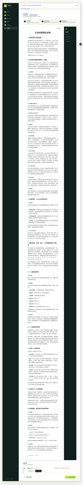
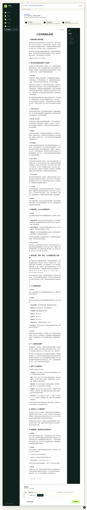
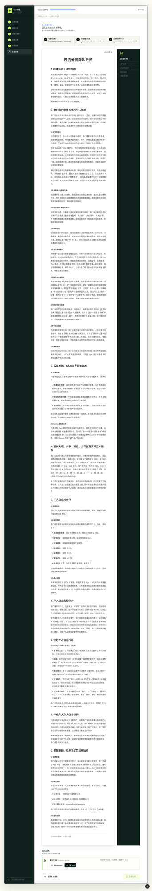
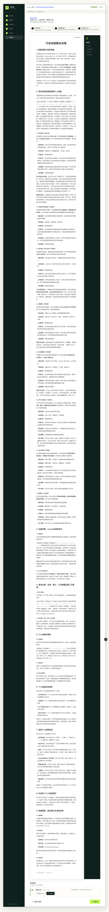

# QA Report: 隐私政策生成器

| Field | Value |
|-------|-------|
| Date | 2026-08-14 |
| URL | http://127.0.0.1:3000/projects/map-msslvjx6c580b4/draft |
| Branch | main |
| Tier | Standard |
| Scope | 草稿重新生成、最新记录更新与 Word 下载 |
| Framework | Next.js 16 |

## Baseline Health Score: 92/100

| Category | Score |
|----------|-------|
| Console | 70 |
| Links | 100 |
| Visual | 100 |
| Functional | 85 |
| UX | 85 |
| Performance | 90 |
| Content | 100 |
| Accessibility | 100 |

## Final Health Score: 100/100

| Category | Before | After |
|----------|--------|-------|
| Console | 70 | 100 |
| Links | 100 | 100 |
| Visual | 100 | 100 |
| Functional | 85 | 100 |
| UX | 85 | 100 |
| Performance | 90 | 100 |
| Content | 100 | 100 |
| Accessibility | 100 | 100 |

## Issues

### ISSUE-001: 重新生成请求固定返回 400

| Field | Value |
|-------|-------|
| Severity | high |
| Category | functional |
| URL | http://127.0.0.1:3000/projects/map-msslvjx6c580b4/draft |

**Description:** 已有成功草稿时点击“生成隐私政策草稿/重新生成”，页面提交 `acknowledgedPreflightReviewToken: null`。服务端输入 Schema 拒绝 null 并返回 `INVALID_DRAFT_INPUT`，页面只显示笼统失败提示，最新成功记录不更新。

**Repro Steps:**

1. 打开已有成功记录的草稿页。
   
2. 点击页面底部的生成或重新生成按钮。
3. 页面显示“本次生成未完成，请稍后重试”，控制台出现 `/api/draft/demo` 400。
   

**Root cause:** 当前没有阻断项时，前端用空数组执行 `every()` 得到 `true`，继而把值为 `null` 的 `acknowledgedPreflightReviewToken` 写入请求。服务端只接受缺省字段或合法 SHA-256 字符串，因而在模型调用前拒绝输入。

**Fix:** 只有同时存在有效审查令牌、存在阻断项且当前阻断项已全部确认时才提交令牌；否则省略该字段。

**Verification:**

- 第一次重新生成：`POST /api/draft/demo` → 200，59.248 秒；最新成功记录更新。
- 第二次连续重新生成：`POST /api/draft/demo` → 200，43.564 秒；按钮从“正在生成…”恢复为“重新生成”。
- Markdown 预览可展开；最新快照 Word 可下载，解包校验无错误并可提取正文。
- 桌面与 390×844 移动视口均无横向内容溢出；生成期间保留上一份成功结果可供查看。
- 两次生成后控制台错误数为 0。

**Commits:**

- `aa896bf` — `fix(qa): ISSUE-001 — omit empty review token on regeneration`
- `e905e7d` — `test(qa): regression test for ISSUE-001 — regeneration review token`

## Regression coverage

- 空令牌且无阻断项时不提交字段。
- 只有全部当前阻断项已确认时才提交有效令牌。
- 两标签页之外的重复点击由生成中禁用状态阻止；连续两轮实际模型生成均成功。
- DOCX 通过 ZIP 完整性和 Word 文本解析检查。

## Summary

| Severity | Count |
|----------|-------|
| Critical | 0 |
| High | 1 |
| Medium | 0 |
| Low | 0 |
| Total | 1 |

## Ship readiness

**READY.** 本次范围内无遗留 Critical、High 或 Medium 问题。慢速模型调用期间有明确进行中状态，并保留上一份成功产物；重试、预览和下载链路均已验证。
