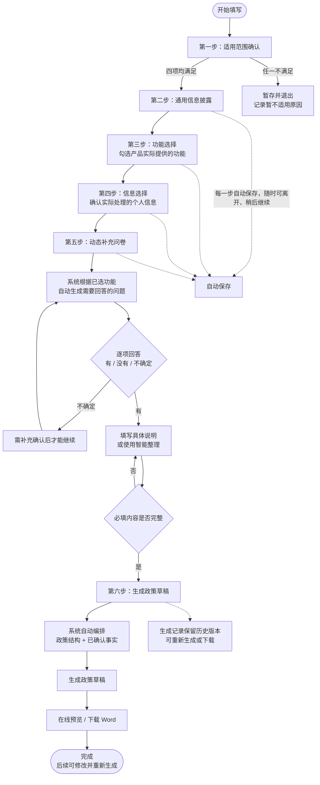

# 隐私政策表单填写流程（客户版）

> 本图用于向客户展示“从开始填写到生成隐私政策”的完整流程，不含系统实现细节。

## 流程要点

1. **适用范围**：先判断产品是否属于地图导航类首期范围；不满足时不会强行生成，可保存后暂存退出。
2. **填写主体信息**：依次填写通用信息、功能、个人信息，系统会按已选功能展示对应的信息项。
3. **动态补充问卷**：不是固定不变的问卷，而是根据“你选了什么功能”自动生成需要确认的问题；回答“有”时可继续填写细节，回答“不确定”会要求补充后才能继续。
4. **自动生成**：所有必填内容确认后，系统自动把政策结构和已确认事实编排成草稿，支持在线预览和下载 Word。
5. **保存与追溯**：每一步自动保存，中途可退出；每次生成结果都会留档，方便修改后重新生成。
